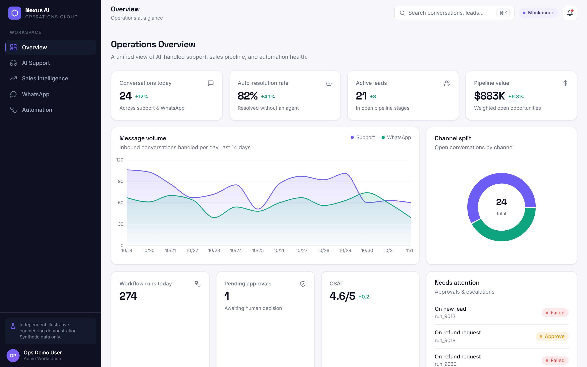
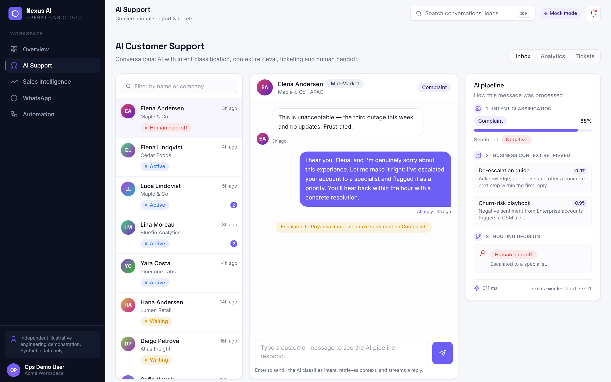
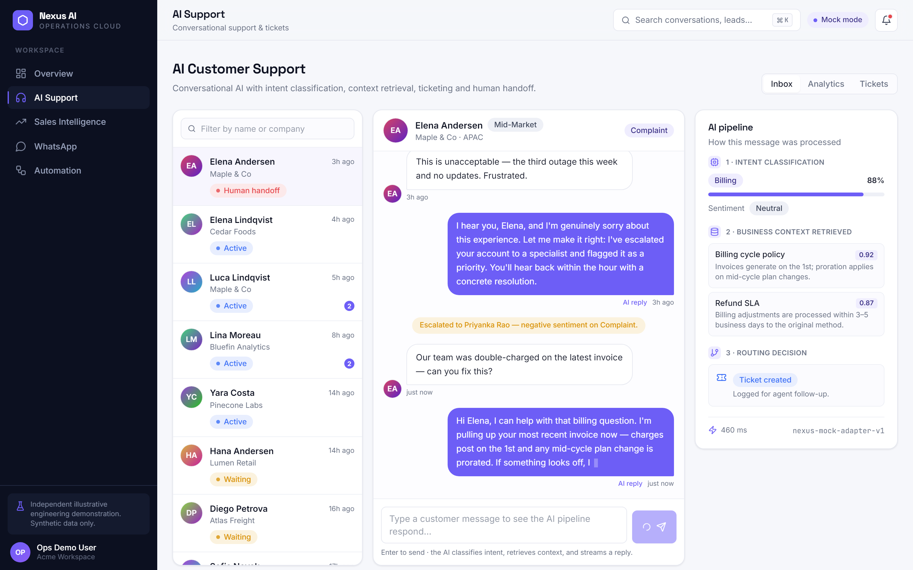
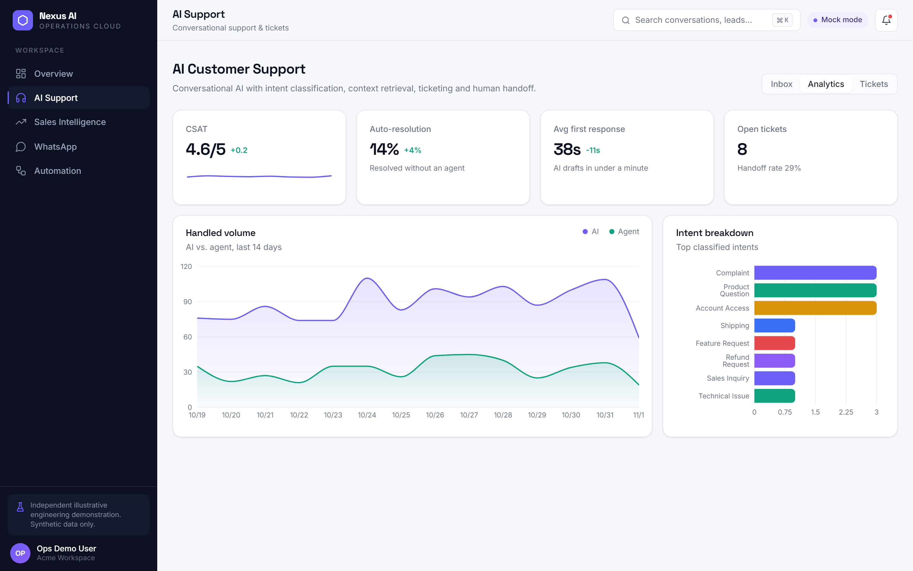
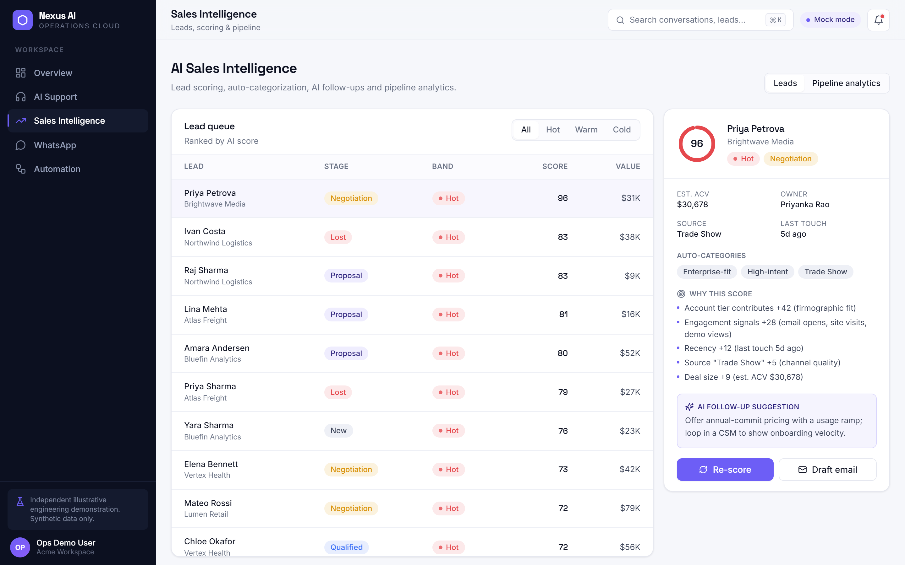
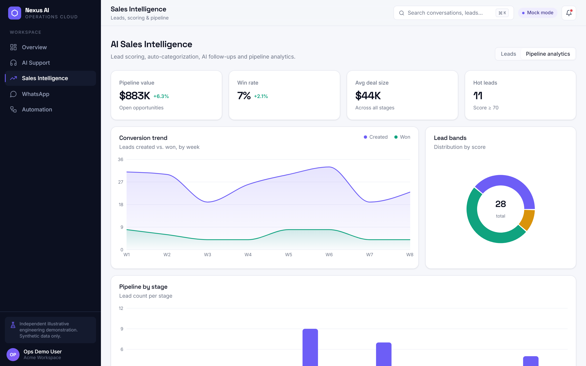
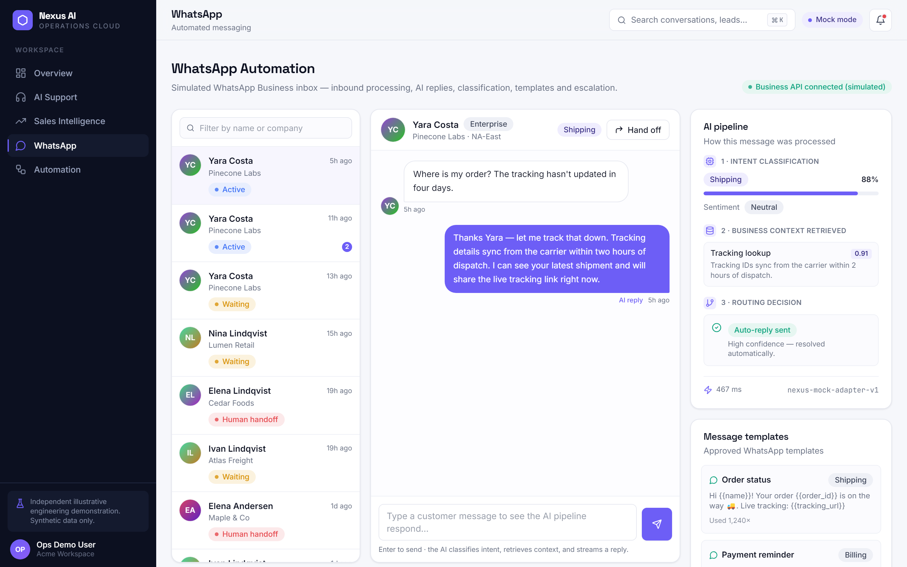
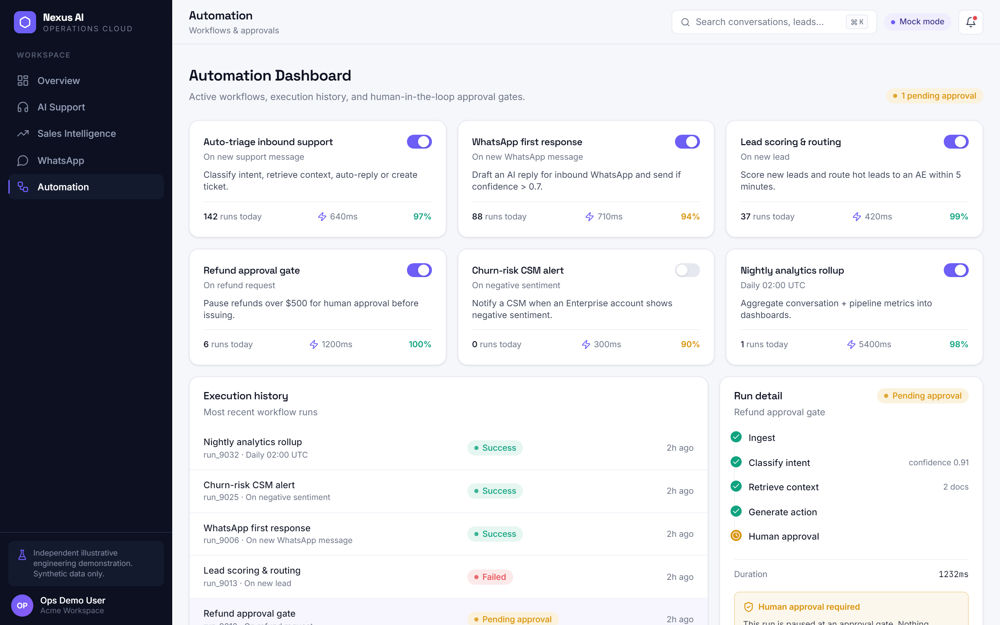

# Nexus AI — Enterprise AI Operations Platform

> **Independent illustrative engineering demonstration.** Nexus AI is an
> original portfolio artifact built to demonstrate full-stack + AI engineering
> capability. It is **not** affiliated with, and does not represent, any real
> company, product, or customer. **All data is synthetic.**

An integrated AI operations platform that unifies customer support, sales
intelligence, WhatsApp automation, and workflow orchestration behind a single
explainable AI pipeline — with human-in-the-loop approval for risky actions.



---

## Highlights

- **One AI pipeline** for all inbound messages: `classify intent → retrieve
  business context → generate reply/action → route (auto-reply · ticket ·
  human handoff)` — fully visualized in the UI.
- **Vendor-agnostic AI** via an `AIAdapter` interface: deterministic mock by
  default, OpenAI / Claude opt-in through env vars.
- **Runs with zero setup** — mock adapters + SQLite fallback mean no API keys
  and no database are required to run or demo.
- **Real backend** — FastAPI + SQLAlchemy + Pydantic, Postgres/Supabase-ready.
- **Streaming replies** over Server-Sent Events.
- **Distinctive enterprise design** — dark rail, violet signal accent, real
  Recharts, polished loading/empty/error states.

## Modules

| Module | What it does |
|--------|--------------|
| **Overview** | Unified KPIs, message-volume trend, channel split, needs-attention queue |
| **AI Support** | Streaming AI chat, intent classification, live pipeline panel, auto-ticketing, escalation, human handoff, analytics |
| **Sales Intelligence** | Lead queue, explainable scoring, auto-categorization, AI follow-ups, re-score, pipeline analytics |
| **WhatsApp** | Simulated Business API inbox, inbound processing, AI replies, templates, escalation |
| **Automation** | Workflows + toggles, execution history, step-level run traces, human approval gates |

## Screenshots

| | |
|---|---|
|  |  |
|  |  |
|  |  |
|  | |

🎬 **Walkthrough video:** [`demo/nexus-ai-walkthrough.mp4`](./demo/nexus-ai-walkthrough.mp4)
(44s, recorded live) · script & storyboard: [`demo/walkthrough.md`](./demo/walkthrough.md)

## Deploy your own

**Fastest — public demo in ~2 minutes (mock mode, no backend/DB):**

[](https://vercel.com/new/clone?repository-url=https://github.com/lalithyachavala/nexus-ai&root-directory=apps/web&env=NEXT_PUBLIC_API_MODE&envDescription=Set%20NEXT_PUBLIC_API_MODE%20to%20mock%20for%20a%20zero-backend%20demo)

Click → sign in to **your** Vercel → confirm **Root Directory = `apps/web`** →
set `NEXT_PUBLIC_API_MODE=mock` → Deploy. The result is a fully interactive
public URL (chat, charts, approvals all work) with no backend or database.

**Full live stack (Vercel + FastAPI + Postgres):**

[](https://render.com/deploy?repo=https://github.com/lalithyachavala/nexus-ai)

Deploys the FastAPI backend (reads `infra/render.yaml`). Then import the repo
to Vercel in `live` mode. Full runbook — including Supabase + the CORS
step — in [`DEPLOY.md`](./DEPLOY.md).

## Architecture

System + AI message-processing sequence diagrams (Mermaid):
[`docs/architecture.md`](./docs/architecture.md).
Full technical case study: [`docs/case-study.md`](./docs/case-study.md).

```
nexus-ai/
├── apps/
│   ├── web/          # Next.js 14 · TS · Tailwind · Recharts
│   │   ├── app/      # routes + mock /api dispatcher (route handlers)
│   │   ├── components/
│   │   └── lib/      # types, api client, mock engine + analytics
│   └── api/          # FastAPI · SQLAlchemy · Pydantic
│       └── app/      # models, schemas, ai (adapters), pipeline, seed, analytics
├── infra/            # docker-compose (postgres + api + web)
├── scripts/          # Playwright capture (screenshots + video)
├── docs/             # architecture, case study, spec
├── demo/             # walkthrough script + MP4
└── screenshots/
```

---

## Quick start

### Option A — Web only, mock mode (fastest, zero setup)

```bash
cd apps/web
npm install
npm run dev            # http://localhost:3000
```

The app defaults to `NEXT_PUBLIC_API_MODE=mock`: all data is served by Next
route handlers backed by a deterministic in-memory engine. No backend, no
database, no keys.

### Option B — Full stack (web + FastAPI)

```bash
# Terminal 1 — backend
cd apps/api
python -m venv .venv
.venv/Scripts/activate        # Windows  (source .venv/bin/activate on macOS/Linux)
pip install -r requirements.txt
cp .env.example .env          # optional: set DATABASE_URL / LLM_PROVIDER
uvicorn app.main:app --port 8000 --reload

# Terminal 2 — frontend in live mode
cd apps/web
npm install
NEXT_PUBLIC_API_MODE=live NEXT_PUBLIC_API_URL=http://localhost:8000 npm run dev
```

The backend boots with a SQLite database (`nexus.db`) and seeds synthetic data
automatically on first run.

### Option C — Docker (production-shaped)

```bash
cd infra
docker compose up --build       # web :3000 · api :8000 · postgres :5432
```

## Configuration

**Backend** (`apps/api/.env`, all optional — see `.env.example`):

| Var | Default | Purpose |
|-----|---------|---------|
| `DATABASE_URL` | `sqlite:///./nexus.db` | Postgres/Supabase in prod |
| `LLM_PROVIDER` | `mock` | `mock` · `openai` · `claude` |
| `OPENAI_API_KEY` / `ANTHROPIC_API_KEY` | — | required only for live LLM |
| `CORS_ORIGINS` | `http://localhost:3000` | allowed web origin(s) |

**Supabase:** set
`DATABASE_URL=postgresql+psycopg2://postgres:<pw>@db.<ref>.supabase.co:5432/postgres`
in `apps/api/.env`. The SQLAlchemy models are Postgres-compatible; tables are
created and seeded on startup.

**Frontend** (`apps/web/.env.local`, see `.env.example`):

| Var | Default | Purpose |
|-----|---------|---------|
| `NEXT_PUBLIC_API_MODE` | `mock` | `mock` (route handlers) or `live` (FastAPI) |
| `NEXT_PUBLIC_API_URL` | `http://localhost:8000` | FastAPI base URL in live mode |

## Demo assets

```bash
cd scripts
npm install
npx playwright install chromium
npm run shots     # → ../screenshots (8 PNGs)
npm run video     # → ../demo/nexus-ai-walkthrough.mp4 (needs ffmpeg on PATH)
```

## Engineering notes

- TypeScript throughout with explicit domain types (`apps/web/lib/types.ts`),
  mirrored by Pydantic schemas on the backend.
- Reusable component library (buttons, badges, cards, stat tiles, charts) with
  consistent loading / empty / error states.
- Input validation + typed error handling on both client and server.
- Clear frontend/backend separation; identical request/response shapes across
  mock and live modes.

## Limitations

See the [case study](./docs/case-study.md#10-limitations-of-the-demonstration).
In short: mock AI is deterministic heuristics (real providers opt-in), auth is
stubbed, WhatsApp is a faithful simulation of the Business API contract, and
analytics are synthetic time series.

---

*Built as an independent engineering demonstration. Synthetic data only; no real
accounts, customers, or integrations.*
