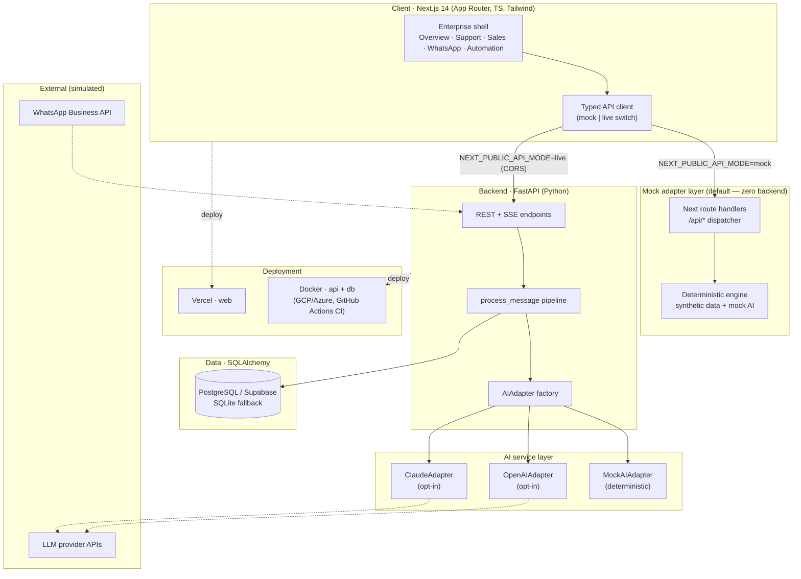
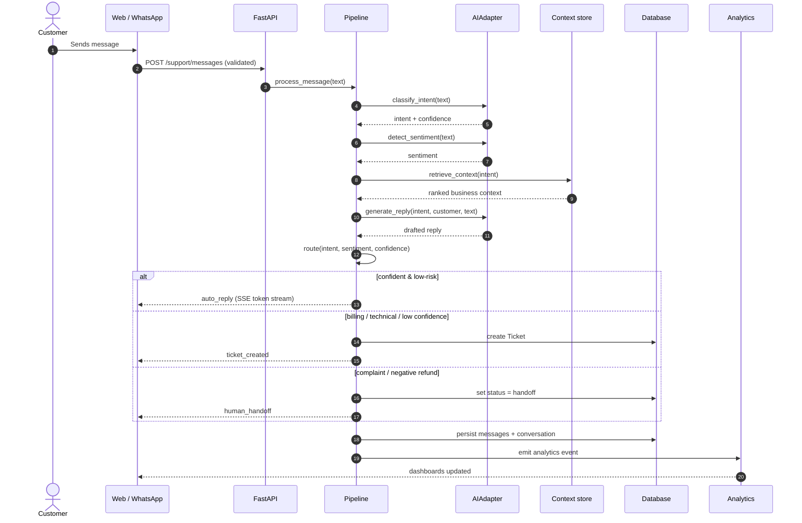
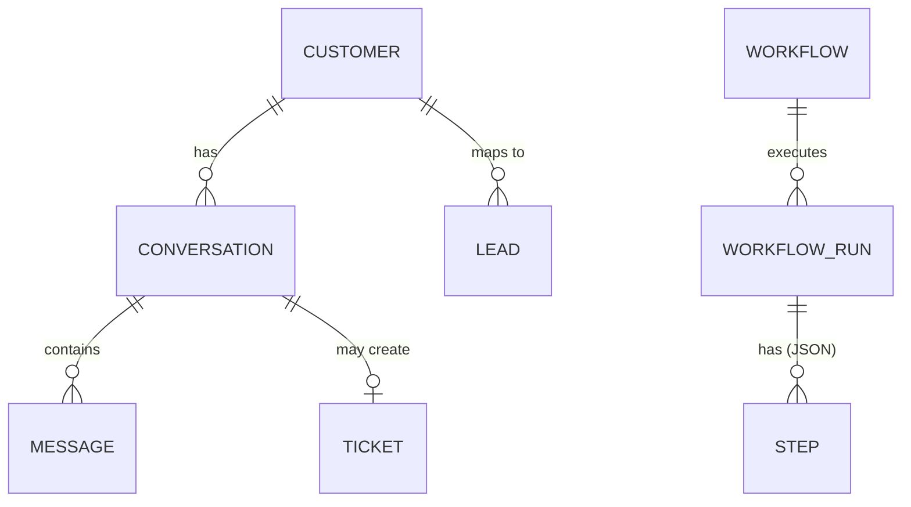

# Nexus AI — Architecture

> Independent illustrative engineering demonstration. Synthetic data only.

## System architecture

**Trust boundary & security.** Secrets live only in `apps/api/.env` (never
shipped to the client). The client never holds an LLM key — the backend owns
all provider calls. Mock mode requires no key at all, so the demo is safe to
run and share. Pydantic validates every request body; typed problem responses
are returned on validation and not-found errors.

## AI message-processing sequence

How an inbound message (Support or WhatsApp) flows through the single
`process_message` pipeline:

## Routing rules (deterministic in mock mode)

| Condition | Route |
|-----------|-------|
| `complaint`, or `refund_request` + negative sentiment | `human_handoff` |
| confidence < 0.55, or `technical_issue` / `billing` | `ticket_created` |
| otherwise | `auto_reply` |

## Data model (core entities)

